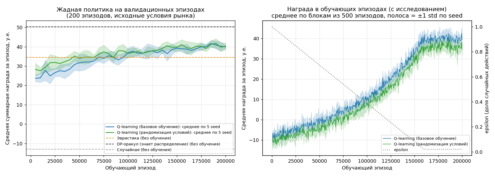
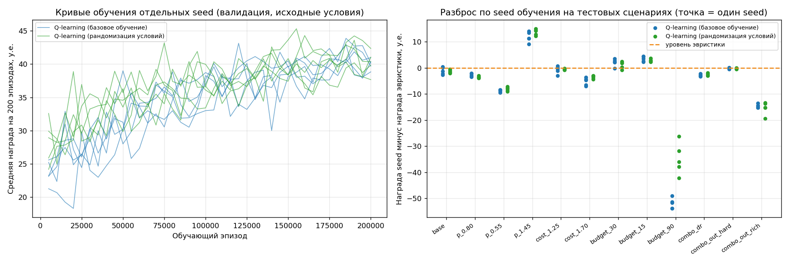
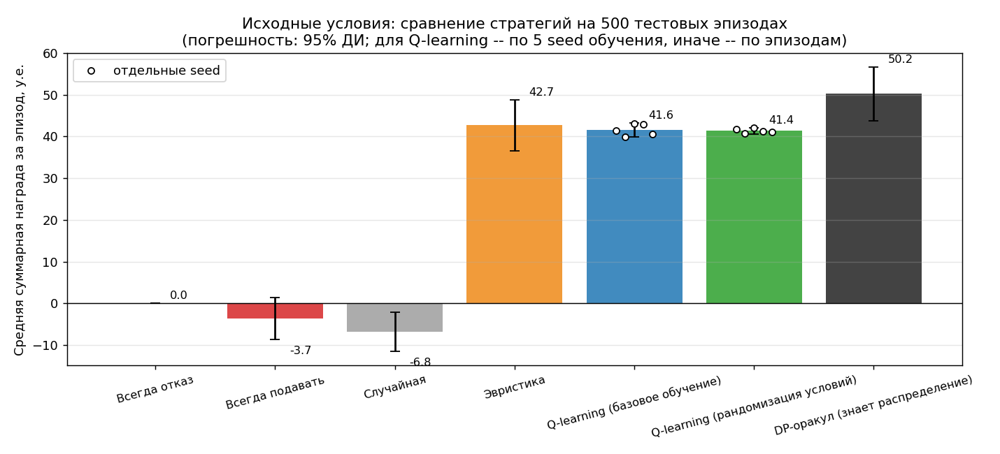
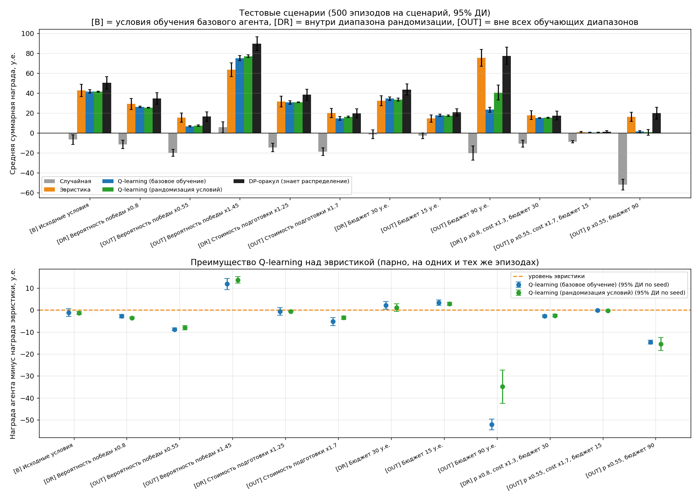
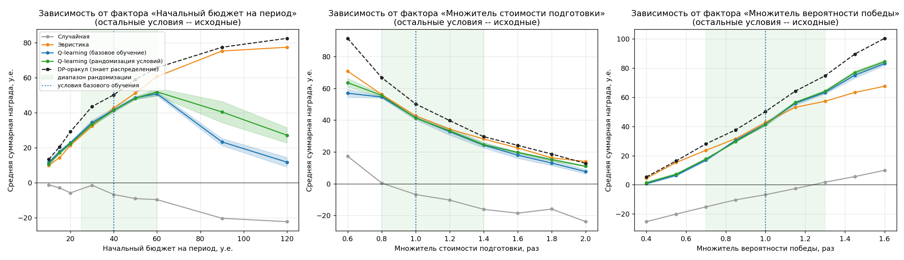
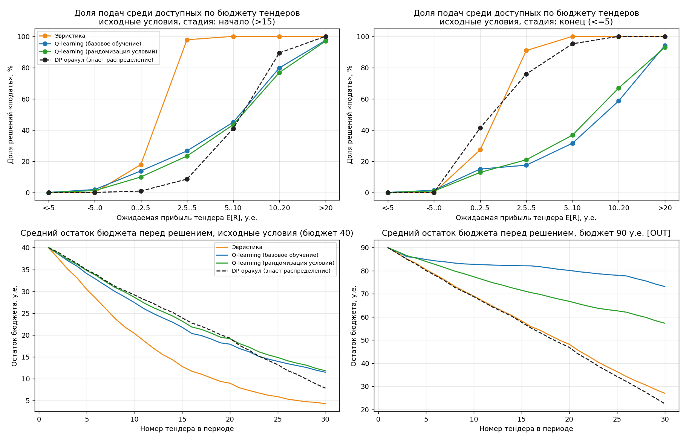
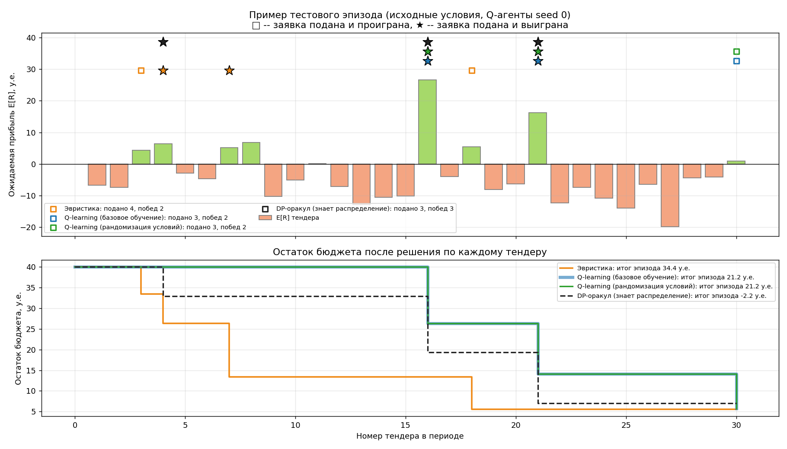

# RL-распределение бюджета между тендерными заявками

Учебное исследование (трек 2 «RL в собственной предметной области»). Агент табличного
Q-learning решает, на какие тендеры тратить ограниченный бюджет на подготовку заявок.
Его сравнивают со случайной стратегией, эвристикой «аналитика» и справочным DP-оракулом.
Отдельно проверяется, как качество стратегии меняется при сдвиге условий рынка и помогает ли
рандомизация условий при обучении (domain randomization).

Среда полностью синтетическая: реальные площадки, персональные данные и финансовые
обязательства не используются. Все суммы указаны в условных единицах (у.е.).

**Коротко о результате.** В исходных условиях Q-learning **не превзошёл** эвристику:
41.6 у.е. против 42.7 у.е., разница −1.1 ± 1.7 у.е. (95% ДИ по 5 seed). Обе стратегии
набирают 82–85% от оракула. Преимущество RL зависит от направления сдвига условий:
- при дефиците бюджета или росте вероятности победы RL выигрывает у эвристики от +2 до +14 у.е.
  во всех или почти всех seed;
- при избытке бюджета, падении вероятности победы или росте стоимости RL проигрывает
  от 3 до 52 у.е.

Рандомизация условий при обучении помогла существенно только в одном сценарии, где базовый агент
попадал в непосещённые при обучении состояния (бюджет 90 у.е.: +17.1 ± 7.9 у.е.).

---

## Содержание
1. [Исследовательский вопрос и гипотеза](#1-исследовательский-вопрос-и-гипотеза)
2. [Предметная область](#2-предметная-область)
3. [Формальное описание среды](#3-формальное-описание-среды)
4. [Q-learning](#4-q-learning)
5. [Стратегии для сравнения](#5-стратегии-для-сравнения)
6. [План эксперимента](#6-план-эксперимента)
7. [Метрики](#7-метрики)
8. [Результаты](#8-результаты)
9. [Поведение агента и примеры решений](#9-поведение-агента-и-примеры-решений)
10. [Анализ ошибок и неожиданных результатов](#10-анализ-ошибок-и-неожиданных-результатов)
11. [Ответ на исследовательский вопрос](#11-ответ-на-исследовательский-вопрос)
12. [Ограничения](#12-ограничения)
13. [Установка и запуск](#13-установка-и-запуск)
14. [Воспроизводимость: seed и версии](#14-воспроизводимость-seed-и-версии)
15. [Структура проекта](#15-структура-проекта)

---

## 1. Исследовательский вопрос и гипотеза

**Вопрос.** Повышает ли обучение с подкреплением качество распределения ограниченного
ресурса между тендерными заявками по сравнению с эвристической стратегией и как устойчивость
полученной стратегии меняется при изменении условий?

**Гипотеза.** Агент RL научится выбирать заявки с учётом выгоды, вероятности победы, затрат,
риска и остатка бюджета. В исходных условиях он превзойдёт простую эвристику, но при изменении
распределения характеристик тендеров его преимущество может уменьшиться.

**Обоснование.** Эвристика оценивает каждый тендер отдельно: «подать, если ожидаемая прибыль
достаточна». Она не учитывает, что бюджет, потраченный сейчас, будет недоступен для лучших
тендеров позже. Это задача последовательного выбора с ограниченным ресурсом, близкая к задаче
о рюкзаке с поступлением предметов во времени. Оптимальный порог подачи в ней зависит от остатка
бюджета и числа оставшихся тендеров. RL может выучить такую зависимость, эвристика её не видит.
С другой стороны, выученный порог «откалиброван» под обучающее распределение тендеров: если рынок
меняется, а состояние агента не содержит информации о рынке, калибровка может стать неверной.
Эвристика от распределения не зависит.

**Основная метрика:** средняя суммарная награда за эпизод на 500 тестовых эпизодах.
**Дополнительные:** чистая прибыль, маржа побед, штрафы, затраты, число заявок и побед,
доля побед, доля использованного бюджета, доля эпизодов с нарушением ограничений.

**Сравниваемые условия обучения** (отличаются одним фактором):
- *базовое* (`q_base`): все обучающие эпизоды в исходных условиях рынка;
- *экспериментальное* (`q_dr`): в каждом обучающем эпизоде множитель вероятности победы,
  множитель стоимости и бюджет выбираются случайно из заданного диапазона.

Число эпизодов, гиперпараметры, seed тендеров и процедура оценки у двух условий одинаковы.

## 2. Предметная область

Условная организация в течение одного периода (эпизода) получает поток из 30 тендеров.
Подготовка заявки требует ресурсов: документов, расчётов, работы специалистов. Эти ресурсы
выражены единым бюджетом периода (по умолчанию 40 у.е.); неизрасходованный бюджет просто
остаётся. По каждому тендеру нужно сразу решить, готовить заявку или нет: тендер нельзя
отложить, будущие тендеры заранее неизвестны. Выигранный тендер приносит маржу, но контракт
может сопровождаться инцидентом при исполнении (штраф, срыв сроков), который съедает маржу
и приносит убыток.

## 3. Формальное описание среды

Реализация: [`src/environment.py`](src/environment.py), класс `TenderPortfolioEnv(gymnasium.Env)`.
Все параметры собраны в [`src/config.py`](src/config.py).

### Генерация тендеров

| Признак | Формула | Смысл |
|---|---|---|
| маржа $V$ | $V \sim U(10, 100)$ | прибыль в случае победы, у.е. |
| вероятность победы $p$ | $p = \mathrm{clip}(s_p \cdot U(0.05, 0.60),\ 0.01,\ 0.95)$ | оценка шанса выиграть |
| стоимость подготовки $c$ | $c = s_c \cdot (2 + 0.08 V + U(0, 5))$ | крупные тендеры дороже готовить, в базе $c \in [2.8, 15]$ |
| риск $r$ | $r \sim U(0, 0.8)$ | вероятность инцидента при исполнении выигранного контракта |

Условия рынка `MarketConditions`: множитель вероятности победы $s_p$ (`p_scale`, исходно 1.0),
множитель стоимости $s_c$ (`cost_scale`, исходно 1.0) и начальный бюджет $B_0$
(`initial_budget`, исходно 40 у.е.).

Все случайные величины эпизода генерируются в `reset()` из seed: признаки тендеров и равномерные
числа $u_{win}, u_{risk}$ для исходов. Поэтому все стратегии видят **одни и те же тендеры
с одними и теми же исходами** (common random numbers), и сравнение получается парным. Условия
рынка только масштабируют одни и те же базовые случайные числа, так что сценарии с одним seed
различаются лишь исследуемым фактором.

### Наблюдение, действия, завершение

- **Наблюдение** `Box(7,), float32`:
  `[V, p, c, r, остаток бюджета, оставшиеся шаги, can_afford]`. Флаг `can_afford`
  отражает доступность ресурса, $c \le$ бюджет. Маска допустимых действий передаётся также
  в `info["action_mask"]`.
- **Действия** `Discrete(2)`: `0` — отказаться, `1` — подготовить и подать заявку.
- **Ограничение.** Если бюджета не хватает, действие `1` не выполняется: бюджет не меняется,
  награда 0, `info["invalid_action"]=True`. Бюджет не может стать отрицательным. Все
  стратегии, включая агента, выбирают только допустимые действия по маске.
- **Завершение.** `terminated=True` после 30-го тендера; `truncated` всегда `False`.
- **Воспроизводимость.** `reset(seed=...)` полностью определяет эпизод.

### Функция награды

При отказе награда равна 0. При подаче заявки:

$$
R = \mathbb{1}[\text{win}]\cdot V \;-\; \mathbb{1}[\text{win} \wedge \text{incident}]\cdot \kappa V \;-\; c,
\qquad \text{win}: u_{win} < p,\quad \text{incident}: u_{risk} < r,
$$

$$
\mathbb{E}[R] = p\,V\,(1 - \kappa r) - c,\qquad \kappa = 1.5 .
$$

| Компонент | Смысл |
|---|---|
| $V$ при победе | ожидаемая выгода от успешного участия |
| $-c$ | затраты на подготовку, списываются всегда, даже при проигрыше |
| $p$ | вероятность победы входит через случайный исход |
| $-\kappa V$ при инциденте | последствия рискованного решения; $\kappa=1.5$ означает, что инцидент не только съедает маржу, но и даёт убыток $0.5V$; при $r > 1/\kappa \approx 0.67$ участие убыточно в ожидании при любых $p, V$ |
| ограниченный бюджет | награда за бюджет не начисляется; потраченный бюджет уменьшает возможности в будущем, и это ограничение выражено через динамику, а не через бонус |

Награда за эпизод равна **чистой прибыли периода** в у.е. Других бонусов или штрафов нет.

**Проверка на лазейки** (тесты и фактическая оценка в разделе 8):
- постоянный отказ даёт ровно 0;
- «подавать на всё» и случайная стратегия расходуют 95–96% бюджета и получают
  отрицательную награду (−3.7 и −6.8 у.е.);
- попытка подать без бюджета не даёт награды и не меняет бюджет;
- нарушений ограничений (бюджет < 0) нет ни в одном из 500 тестовых эпизодов ни у одной стратегии.

Тесты корректности награды: `tests/test_environment.py::test_reward_formula` проверяет три
исхода (проигрыш, победа, победа с инцидентом), `test_expected_reward_matches_simulation`
сверяет $\mathbb{E}[R]$ с методом Монте-Карло.

### Выбор параметров среды

Параметры генератора и $\kappa$ заданы из содержательных соображений: в среднем около трети
тендеров выгодны в ожидании, бюджета хватает примерно на 4 заявки из 30. До обучения RL, только
на валидационных эпизодах, проверено, что задача нетривиальна. При первоначальной длине периода
20 тендеров эвристика уже набирала 93% от оракула, и бюджет почти не ограничивал выбор. Поэтому
длина периода увеличена до 30: эвристика стала набирать 78% от оракула на валидации, а при
бюджете 20 у.е. 67%. Правила эвристики при этом не менялись. Это разовая проверка на
400 валидационных эпизодах при проектировании среды; её результаты в `results/`
не сохранялись.

## 4. Q-learning

Реализация: [`src/agent.py`](src/agent.py), обучение: [`src/train.py`](src/train.py).

### Дискретизация состояния

Для табличного метода наблюдение переводится в индекс строки Q-таблицы (`StateDiscretizer`).
Границы интервалов абсолютные, не зависят от условий рынка:

| Признак | Границы | Число интервалов |
|---|---|---|
| $V$ | 40, 70 | 3 |
| $p$ | 0.15, 0.30, 0.45 | 4 |
| $c$ | 6, 10 | 3 |
| $r$ | 0.25, 0.50 | 3 |
| темп бюджета $\text{pace} = B / (\text{шагов} \cdot 9)$ | 0.10, 0.20, 0.35, 0.60 | 5 |
| стадия периода (оставшихся шагов) | ≤5 / 6–15 / >15 | 3 |
| `can_afford` | — | 2 |

Итого $3\cdot4\cdot3\cdot3\cdot5\cdot3\cdot2 = 3240$ состояний × 2 действия. Темп бюджета
показывает, на сколько «средних» заявок (средняя стоимость в базе около 9 у.е.) хватает
бюджета на один оставшийся тендер. Это объединяет остаток бюджета и оставшееся время
в признак, от которого зависит оптимальная строгость отбора. Ожидаемая прибыль $\mathbb{E}[R]$
агенту **не передаётся**: он должен сам выучить ценность комбинаций признаков. За время
обучения базовый агент посетил 58.3–58.6% состояний, агент DR 63.2–63.3%. Часть комбинаций
недостижима: например, дешёвый крупный тендер невозможен из-за связи $c$ и $V$.

### Алгоритм

$$
Q(s,a) \leftarrow Q(s,a) + \alpha(s,a)\big[r + \gamma \max_{a' \in A(s')} Q(s',a')\,(1-\text{done}) - Q(s,a)\big]
$$

- максимум берётся только по допустимым в $s'$ действиям;
- epsilon-greedy среди допустимых действий; $\varepsilon$ линейно убывает от 1.0 до 0.02
  за первые 80% эпизодов;
- learning rate зависит от числа посещений: $\alpha(s,a) = \max(0.01,\ (1+n(s,a))^{-0.6})$.
  Награда сильно зашумлена (исход случайный), а такой шаг усредняет шум лучше постоянного;
- $\gamma = 0.95$; начальные значения $Q = 0$;
- при равенстве Q-значений выбирается отказ. Это относится и к состояниям, не посещённым при
  обучении (консервативное поведение «не тратить при отсутствии знаний»);
- 200 000 обучающих эпизодов (6 млн шагов) на запуск, 5 seed на каждое условие;
- каждые 5000 эпизодов жадная политика оценивается на 200 валидационных эпизодах (исходные
  условия). Это кривая обучения; история и Q-таблицы сохраняются в `results/policies/`.

### Подбор гиперпараметров (только валидация)

[`src/tune.py`](src/tune.py): seed агента 99 (не входит в основной эксперимент), 100 000
эпизодов, базовые условия, 500 валидационных эпизодов. Тестовые сценарии не использовались.

| Конфигурация | Валидационная награда, у.е. |
|---|---|
| $\alpha$ по посещениям, $\gamma=0.95$ | **45.26** |
| $\alpha=0.05$, $\gamma=0.95$ | 42.85 |
| $\alpha$ по посещениям, $\gamma=1.0$ | 41.15 |
| $\alpha=0.05$, $\gamma=1.0$ | 38.32 |
| $\alpha=0.1$, $\gamma=1.0$ | 31.85 |
| $\alpha=0.1$, $\gamma=0.95$ | 29.83 |

Выбрана первая строка. Разница с соседними конфигурациями сопоставима с шумом валидации
(SE ≈ 2.8 у.е.), и подбор сделан на одном seed. Полные кривые сохранены в
`results/tuning_validation.csv`.

## 5. Стратегии для сравнения

Реализация: [`src/policies.py`](src/policies.py). Все стратегии проходят одни и те же эпизоды.

| Стратегия | Описание |
|---|---|
| **Случайная** | равновероятный выбор среди допустимых действий (seed 12345) |
| **Эвристика** | подать, если бюджета хватает, $\mathbb{E}[R] \ge 0.25\,c$ (ожидаемая отдача ≥ 25% затрат) и $r \le 0.6$. Пороги заданы a priori в `HeuristicConfig` до обучения RL и не подбирались ни на валидации, ни на тесте. Эвристика знает точную формулу $\mathbb{E}[R]$, но не учитывает будущее |
| **Q-learning base / DR** | жадная политика по Q-таблице, без дообучения |
| **DP-оракул** (справочный) | оптимальная по ожиданию стратегия, которая **знает распределение тендеров текущего сценария**, но не будущие тендеры и не исходы. Функция ценности $W_k(b) = \mathbb{E}_x[\max(W_{k-1}(b),\ \mathbb{1}[c\le b](\mathbb{E}[R\mid x] + W_{k-1}(b-c)))]$ считается обратной индукцией по сетке бюджета с шагом 0.25 и выборке 4000 тендеров. Это верхний ориентир «насколько хорошо можно сделать», а не конкурент |
| Всегда отказ / всегда подавать | проверка функции награды на лазейки |

## 6. План эксперимента

1. Зафиксировать параметры среды, эвристику, seed и тестовые сценарии ([`src/config.py`](src/config.py)).
2. Подобрать $\alpha, \gamma$ на валидации ([`src/tune.py`](src/tune.py)).
3. Обучить по 5 агентов в условиях base и DR ([`src/train.py`](src/train.py)).
4. Оценить все стратегии без обучения на 12 тестовых сценариях и 26 точках однофакторных
   развёрток, по 500 тестовых эпизодов на точку ([`src/evaluate.py`](src/evaluate.py)).
5. Проанализировать поведение на 200 тестовых эпизодах ([`src/behavior.py`](src/behavior.py)).
6. Построить графики и таблицы из сохранённых CSV ([`src/report.py`](src/report.py)).

**Диапазоны рандомизации (DR)** при обучении: $s_p \in [0.7, 1.3]$,
$s_c \in [0.8, 1.4]$, $B_0 \in [25, 60]$, независимо и равномерно в каждом эпизоде.

**Тестовые сценарии.** В каждом меняется один фактор относительно исходных условий,
кроме комбинированных. Метки честно указывают пересечение с обучением:
- **[B]** — совпадает с условиями обучения базового агента;
- **[DR]** — внутри диапазона рандомизации: агент DR видел такие условия, базовый нет;
- **[OUT]** — хотя бы один фактор вне всех обучающих диапазонов.

Сценарии [DR] **не являются новыми** для агента DR.

| Сценарий | $s_p$ | $s_c$ | $B_0$ | Метка |
|---|---|---|---|---|
| Исходные условия | 1.0 | 1.0 | 40 | [B] |
| Вероятность победы ×0.8 / ×0.55 / ×1.45 | 0.8 / 0.55 / 1.45 | 1.0 | 40 | [DR] / [OUT] / [OUT] |
| Стоимость ×1.25 / ×1.7 | 1.0 | 1.25 / 1.7 | 40 | [DR] / [OUT] |
| Бюджет 30 / 15 / 90 | 1.0 | 1.0 | 30 / 15 / 90 | [DR] / [OUT] / [OUT] |
| Комбинация внутри DR | 0.8 | 1.3 | 30 | [DR] |
| Комбинация «трудный рынок» | 0.55 | 1.7 | 15 | [OUT] |
| Комбинация «мало побед, много бюджета» | 0.55 | 1.0 | 90 | [OUT] |

Развёртки: бюджет {10, 15, 20, 30, 40, 50, 60, 90, 120}, $s_c$ {0.6 … 2.0}, $s_p$ {0.4 … 1.6}.

**Разделение данных.** Seed обучающих эпизодов: `agent_seed·10^6 + ep` (< 5·10^6),
валидационных: `5·10^8 + i`, тестовых: `10^9 + i`, i = 0…499. Диапазоны не пересекаются.
Тест `test_no_test_seed_leaks_into_training` перехватывает все вызовы `reset` при обучении
обоих типов агентов и проверяет, что тестовые seed не используются.

## 7. Метрики

Для каждой стратегии и сценария (`results/eval_summary.csv`):
- средняя награда (= чистая прибыль), стандартное отклонение по эпизодам, для Q-агентов также
  стандартное отклонение по seed;
- 95% ДИ: для Q-агентов $t_{0.975}(4)\cdot SE$ по 5 seed, для остальных $1.96\cdot SE$
  по 500 эпизодам;
- маржа побед, штрафы за инциденты, затраты на подготовку, число заявок и побед;
- доля побед (суммарные победы / суммарные заявки), доля использованного бюджета;
- доля эпизодов с нарушением бюджета и число недопустимых действий;
- для Q-агентов доля решений в не посещённых при обучении состояниях.

Парное сравнение с эвристикой на одних и тех же эпизодах (`results/paired_vs_heuristic.csv`):
средняя разность, 95% ДИ по seed и по эпизодам, число seed лучше эвристики, доля от оракула,
разность DR − base с ДИ Уэлча.

## 8. Результаты

Все числа ниже получены запуском кода и взяты из `results/summary_tables.md`;
графики построены из сохранённых CSV и JSON.

### 8.1 Кривая обучения



*Слева:* жадная политика на 200 валидационных эпизодах, среднее ± std по 5 seed.
*Справа:* награда в обучающих эпизодах с исследованием. Для агента DR она ниже, потому что
его обучающие эпизоды проходят в других условиях. Обучение даёт явное улучшение относительно
необученного агента: при $\varepsilon \approx 1$ награда около −10 у.е., как у случайной
стратегии. На валидации жадная политика растёт с 21–33 у.е. (первая оценка после 5000 эпизодов)
до 37.7–42.4 у.е. в конце обучения и выходит
на плато примерно после 150 000 эпизодов.



### 8.2 Исходные условия (500 тестовых эпизодов)



| Стратегия | Награда, у.е. (95% ДИ) | Std по эпизодам | Std по seed | Маржа побед | Штрафы | Затраты | Заявок | Побед | Доля побед | Бюджет исп. | Нарушения |
|---|---|---|---|---|---|---|---|---|---|---|---|
| Всегда отказ | 0.00 ± 0.00 | 0.00 | — | 0.00 | 0.00 | 0.00 | 0.00 | 0.00 | — | 0.00 | 0 |
| Всегда подавать | −3.67 ± 5.02 | 57.28 | — | 78.55 | 43.86 | 38.36 | 4.61 | 1.55 | 0.34 | 0.96 | 0 |
| Случайная | −6.79 ± 4.66 | 53.13 | — | 77.06 | 45.89 | 37.97 | 4.54 | 1.53 | 0.34 | 0.95 | 0 |
| Эвристика | 42.72 ± 6.09 | 69.47 | — | 104.57 | 25.90 | 35.95 | 3.94 | 1.64 | 0.42 | 0.90 | 0 |
| Q-learning base | 41.58 ± 1.74 | 63.39 | 1.40 | 91.31 | 20.14 | 29.60 | 3.20 | 1.48 | 0.46 | 0.74 | 0 |
| Q-learning DR | 41.35 ± 0.70 | 63.81 | 0.57 | 89.95 | 19.23 | 29.37 | 3.19 | 1.47 | 0.46 | 0.73 | 0 |
| DP-оракул | 50.20 ± 6.40 | 72.99 | — | 106.58 | 23.41 | 32.97 | 3.54 | 1.59 | 0.45 | 0.82 | 0 |

Парная разность с эвристикой на одних и тех же эпизодах: Q base **−1.14 ± 1.74** у.е.
(ДИ по seed; лучше эвристики 2 из 5 seed), Q DR **−1.37 ± 0.70** у.е. (0 из 5 seed).
Эти ДИ учитывают только разброс между seed обучения на фиксированном наборе тестовых эпизодов.
С учётом разброса по эпизодам ДИ разности около ±5 у.е. Различие RL и эвристики в исходных
условиях мало (около 1 у.е., или 2–3% от награды) и с учётом шума эпизодов статистически
не отличается от нуля. Q-агенты
подают меньше заявок (3.2 против 3.9), выигрывают чаще (46% против 42%) и несут меньше штрафов,
но недоиспользуют бюджет (74% против 90% у эвристики и 82% у оракула).

### 8.3 Устойчивость к изменению условий



| Сценарий | Случайная | Эвристика | Q base (± std seed) | Q DR (± std seed) | Оракул | Q base − эвр. (95% ДИ) | Q DR − эвр. (95% ДИ) | seed Qb/Qdr > эвр. | Q DR − Q base (95% ДИ) |
|---|---|---|---|---|---|---|---|---|---|
| [B] Исходные условия | −6.79 | 42.72 | 41.58 ± 1.40 | 41.35 ± 0.57 | 50.20 | −1.14 ± 1.74 | −1.37 ± 0.70 | 2/5, 0/5 | −0.23 ± 1.74 |
| [DR] p ×0.8 | −11.63 | 29.01 | 26.20 ± 0.63 | 25.43 ± 0.33 | 34.54 | −2.80 ± 0.78 | −3.58 ± 0.41 | 0/5, 0/5 | −0.77 ± 0.78 |
| [OUT] p ×0.55 | −20.09 | 15.29 | 6.49 ± 0.48 | 7.23 ± 0.73 | 16.36 | −8.80 ± 0.60 | −8.06 ± 0.90 | 0/5, 0/5 | +0.74 ± 0.95 |
| [OUT] p ×1.45 | 5.61 | 63.30 | 75.09 ± 2.01 | 76.97 ± 1.13 | 89.60 | **+11.79 ± 2.50** | **+13.67 ± 1.40** | 5/5, 5/5 | +1.88 ± 2.52 |
| [DR] стоимость ×1.25 | −14.76 | 31.38 | 30.64 ± 1.42 | 30.75 ± 0.23 | 38.29 | −0.74 ± 1.76 | −0.63 ± 0.29 | 2/5, 0/5 | +0.11 ± 1.79 |
| [OUT] стоимость ×1.7 | −18.96 | 19.75 | 14.47 ± 1.46 | 16.21 ± 0.59 | 19.39 | −5.28 ± 1.81 | −3.54 ± 0.73 | 0/5, 0/5 | +1.74 ± 1.81 |
| [DR] бюджет 30 | −1.48 | 32.32 | 34.40 ± 1.38 | 33.38 ± 1.36 | 43.55 | **+2.09 ± 1.71** | +1.06 ± 1.69 | 4/5, 4/5 | −1.03 ± 2.05 |
| [OUT] бюджет 15 | −2.98 | 14.36 | 17.72 ± 1.00 | 17.14 ± 0.56 | 20.52 | **+3.36 ± 1.24** | **+2.78 ± 0.70** | 5/5, 5/5 | −0.58 ± 1.25 |
| [OUT] бюджет 90 | −20.38 | 75.29 | 23.30 ± 2.00 | 40.44 ± 6.07 | 77.45 | −51.99 ± 2.49 | −34.86 ± 7.53 | 0/5, 0/5 | **+17.13 ± 7.93** |
| [DR] p ×0.8, стоимость ×1.3, бюджет 30 | −10.97 | 17.77 | 14.94 ± 0.41 | 15.19 ± 0.48 | 17.28 | −2.83 ± 0.51 | −2.58 ± 0.60 | 0/5, 0/5 | +0.25 ± 0.67 |
| [OUT] p ×0.55, стоимость ×1.7, бюджет 15 | −9.12 | 0.56 | 0.35 ± 0.22 | 0.28 ± 0.21 | 0.98 | −0.21 ± 0.28 | −0.28 ± 0.26 | 1/5, 0/5 | −0.07 ± 0.32 |
| [OUT] p ×0.55, бюджет 90 | −52.01 | 15.93 | 1.32 ± 0.72 | 0.52 ± 2.38 | 19.78 | −14.61 ± 0.89 | −15.41 ± 2.96 | 0/5, 0/5 | −0.80 ± 3.09 |

Доля от оракула и поведение:

| Сценарий | Эвристика, % оракула | Q base, % | Q DR, % | Заявок эвр./Qb/Qdr/ор. | Бюджет исп. эвр./Qb/Qdr/ор. | Непосещ. сост. Qb, % | Qdr, % |
|---|---|---|---|---|---|---|---|
| [B] Исходные условия | 85.1 | 82.8 | 82.4 | 3.9/3.2/3.2/3.5 | 0.90/0.74/0.73/0.82 | 0.00 | 0.00 |
| [DR] p ×0.8 | 84.0 | 75.9 | 73.6 | 3.6/2.3/2.4/3.3 | 0.83/0.55/0.56/0.78 | 0.00 | 0.00 |
| [OUT] p ×0.55 | 93.5 | 39.7 | 44.2 | 2.2/0.6/0.8/2.7 | 0.52/0.14/0.18/0.64 | 0.01 | 0.00 |
| [OUT] p ×1.45 | 70.7 | 83.8 | 85.9 | 4.2/3.8/3.8/3.7 | 0.93/0.86/0.85/0.86 | 0.00 | 0.00 |
| [DR] стоимость ×1.25 | 82.0 | 80.0 | 80.3 | 3.0/2.5/2.5/2.7 | 0.84/0.73/0.71/0.78 | 0.15 | 0.00 |
| [OUT] стоимость ×1.7 | 101.9 | 74.6 | 83.6 | 1.7/1.8/1.8/1.7 | 0.69/0.74/0.72/0.69 | 1.03 | 0.05 |
| [DR] бюджет 30 | 74.2 | 79.0 | 76.6 | 3.0/2.5/2.5/2.6 | 0.89/0.76/0.75/0.81 | 0.00 | 0.00 |
| [OUT] бюджет 15 | 70.0 | 86.4 | 83.5 | 1.4/1.2/1.2/1.2 | 0.79/0.70/0.70/0.72 | 0.00 | 0.00 |
| [OUT] бюджет 90 | 97.2 | 30.1 | 52.2 | 6.9/1.9/3.8/7.5 | 0.73/0.19/0.38/0.78 | **36.64** | 0.45 |
| [DR] комбинация | 102.8 | 86.4 | 87.9 | 1.8/1.4/1.3/1.7 | 0.74/0.58/0.57/0.72 | 0.19 | 0.00 |
| [OUT] трудный рынок | 57.0 | 35.9 | 28.5 | 0.1/0.0/0.0/0.2 | 0.07/0.03/0.02/0.18 | 2.19 | 0.09 |
| [OUT] мало побед, много бюджета | 80.5 | 6.7 | 2.6 | 2.3/0.2/1.3/3.9 | 0.25/0.02/0.12/0.42 | **42.87** | 1.33 |

Изменение средней награды относительно исходных условий:

| Сценарий | Эвристика | Q base | Q DR | Оракул |
|---|---|---|---|---|
| [DR] p ×0.8 | −32.1% | −37.0% | −38.5% | −31.2% |
| [OUT] p ×0.55 | −64.2% | −84.4% | −82.5% | −67.4% |
| [OUT] p ×1.45 | +48.2% | +80.6% | +86.1% | +78.5% |
| [DR] стоимость ×1.25 | −26.5% | −26.3% | −25.6% | −23.7% |
| [OUT] стоимость ×1.7 | −53.8% | −65.2% | −60.8% | −61.4% |
| [DR] бюджет 30 | −24.3% | −17.3% | −19.3% | −13.2% |
| [OUT] бюджет 15 | −66.4% | −57.4% | −58.6% | −59.1% |
| [OUT] бюджет 90 | +76.3% | −44.0% | −2.2% | +54.3% |
| [DR] комбинация | −58.4% | −64.1% | −63.3% | −65.6% |
| [OUT] трудный рынок | −98.7% | −99.2% | −99.3% | −98.1% |
| [OUT] мало побед, много бюджета | −62.7% | −96.8% | −98.8% | −60.6% |

Абсолютная награда меняется вместе с рынком у всех стратегий, включая оракула. Поэтому для
оценки устойчивости информативнее доля от оракула и разность с эвристикой, чем процентное
изменение.

### 8.4 Зависимость от бюджета, стоимости и вероятности победы



| Бюджет, у.е. | 10 | 15 | 20 | 30 | **40** | 50 | 60 | 90 | 120 |
|---|---|---|---|---|---|---|---|---|---|
| Эвристика | 9.81 | 14.36 | 21.25 | 32.32 | 42.72 | 51.26 | 60.64 | 75.29 | 77.44 |
| Q base | 11.54 | 17.72 | 22.81 | 34.40 | 41.58 | 48.54 | 50.84 | 23.30 | 11.73 |
| Q DR | 10.64 | 17.14 | 22.24 | 33.38 | 41.35 | 48.22 | 51.93 | 40.44 | 27.13 |
| Оракул | 13.30 | 20.52 | 29.17 | 43.55 | 50.20 | 59.00 | 65.77 | 77.45 | 82.54 |

| Множитель стоимости | 0.6 | 0.8 | **1.0** | 1.2 | 1.4 | 1.6 | 1.8 | 2.0 |
|---|---|---|---|---|---|---|---|---|
| Эвристика | 70.84 | 56.19 | 42.72 | 34.28 | 28.15 | 22.52 | 16.25 | 14.00 |
| Q base | 56.95 | 54.54 | 41.58 | 32.71 | 24.26 | 17.95 | 13.01 | 7.60 |
| Q DR | 63.62 | 55.56 | 41.35 | 33.23 | 24.58 | 19.66 | 15.14 | 10.93 |
| Оракул | 91.47 | 66.81 | 50.20 | 39.73 | 29.59 | 24.15 | 18.66 | 12.77 |

| Множитель вероятности победы | 0.4 | 0.55 | 0.7 | 0.85 | **1.0** | 1.15 | 1.3 | 1.45 | 1.6 |
|---|---|---|---|---|---|---|---|---|---|
| Эвристика | 4.48 | 15.29 | 23.65 | 31.61 | 42.72 | 53.10 | 57.23 | 63.30 | 67.54 |
| Q base | 0.85 | 6.49 | 16.87 | 30.56 | 41.58 | 55.84 | 63.20 | 75.09 | 83.04 |
| Q DR | 1.35 | 7.23 | 17.76 | 29.53 | 41.35 | 56.44 | 64.06 | 76.97 | 84.41 |
| Оракул | 5.39 | 16.36 | 28.08 | 37.67 | 50.20 | 64.20 | 74.71 | 89.60 | 100.39 |

Закономерность одна для всех трёх факторов. RL выигрывает у эвристики, когда хороших
тендеров много относительно бюджета: бюджет ≤ 30 или $s_p \ge 1.15$. Тогда отбор важен,
а эвристика тратит бюджет на первые подходящие тендеры. RL проигрывает, когда бюджета много
относительно хороших тендеров: бюджет ≥ 50 или $s_p \le 0.85$. Тогда оптимально подавать
почти на всё выгодное, а Q-агенты продолжают «копить» бюджет. По стоимости подготовки RL
уступает эвристике при всех значениях, и разрыв растёт к краям: при ×0.6 он составляет
7–14 у.е., при ×2.0 3–6 у.е. Оба направления ослабляют дефицит бюджета. Удешевление
позволяет оплатить больше заявок; удорожание уменьшает число выгодных тендеров, и бюджета
на них хватает.

## 9. Поведение агента и примеры решений



*Вверху:* доля решений «подать» среди тендеров, на которые хватает бюджета, в зависимости от
ожидаемой прибыли тендера (исходные условия, 200 тестовых эпизодов, Q — все 5 seed).
*Внизу:* средний остаток бюджета перед каждым решением.

- **Оракул** использует порог, зависящий от времени: в начале периода он подаёт на 9% тендеров
  с $\mathbb{E}[R] \in [2.5, 5]$, в конце на 76%.
- **Эвристика** держит постоянный порог: на те же тендеры она подаёт в 98% случаев уже
  в начале периода и тратит бюджет быстрее всех.
- **Q-агенты** выучили правильное направление: в начале периода они строги, на тендеры
  $\mathbb{E}[R] \in [2.5, 5]$ подают в 23–27% случаев. Но в конце периода они не «отпускают»
  бюджет: на тендеры $\mathbb{E}[R] \in [5, 10]$ подают лишь в 32–37% случаев (оракул в 95%),
  а на тендеры с $\mathbb{E}[R] > 10$ в 80% случаев (эвристика 100%, оракул 95%). Перед
  последним тендером у Q-агентов остаётся в среднем 11.5–11.8 у.е., у оракула 7.9 у.е.,
  у эвристики 4.3 у.е.
- **Бюджет 90 у.е. [OUT]:** эвристика и оракул тратят бюджет почти одинаково. Базовый Q-агент
  почти не тратит (остаётся 73 у.е.), агент DR тратит больше (остаётся 57 у.е.), но всё ещё
  слишком мало.

**Пример решений** на тестовом эпизоде `seed = 1 000 000 000`, исходные условия, Q-агенты seed 0
([`results/example_episode.csv`](results/example_episode.csv)). Показаны тендеры, на которые
подал хотя бы один участник; 1 означает «подать», номер тендера t от 0:

| t | V | p | c | r | E[R] | Эвристика | Q base | Q DR | Оракул | Исход для подавших |
|---|---|---|---|---|---|---|---|---|---|---|
| 2 | 41.6 | 0.45 | 6.56 | 0.27 | 4.39 | 1 | 0 | 0 | 0 | проигрыш, −6.56 |
| 3 | 49.4 | 0.49 | 7.05 | 0.30 | 6.38 | 1 | 0 | 0 | 1 | победа + инцидент, −31.76 |
| 6 | 93.6 | 0.21 | 13.03 | 0.06 | 5.19 | 1 | 0 | 0 | 0 | победа, +80.52 |
| 15 | 94.2 | 0.54 | 13.64 | 0.14 | 26.58 | 0 | 1 | 1 | 1 | победа, +80.53 |
| 17 | 67.4 | 0.25 | 7.77 | 0.15 | 5.43 | 1 | 0 | 0 | 0 | проигрыш, −7.77 |
| 20 | 77.4 | 0.47 | 12.26 | 0.15 | 16.15 | 0 | 1 | 1 | 1 | победа + инцидент, −50.97 |
| 29 | 23.1 | 0.57 | 8.33 | 0.20 | 0.90 | 0 | 1 | 1 | 0 | проигрыш, −8.33 |

Итог эпизода: эвристика +34.4, Q base и Q DR +21.2, оракул −2.2 у.е. Эвристика потратила
бюджет на ранние средние тендеры и не смогла бы участвовать в лучшем тендере эпизода
(t = 15, E[R] = 26.6). Q-агенты и оракул его дождались. При этом оракулу не повезло:
два инцидента при трёх победах. Пример показывает, что один эпизод мало говорит о качестве
стратегии: стандартное отклонение награды по эпизодам 63–73 у.е. у эвристики, Q-агентов и оракула
при средних 41–50 у.е.,
поэтому выводы сделаны только по 500 парным эпизодам и 5 seed.



## 10. Анализ ошибок и неожиданных результатов

1. **RL не превзошёл эвристику в исходных условиях.** Поведенческий анализ указывает на две
   причины.
   - *Грубое представление состояния.* 4 признака тендера разбиты на 3–4 интервала каждый,
     и в одной ячейке оказываются тендеры как с положительной, так и с отрицательной
     ожидаемой прибылью. Агент принимает решение по средней ценности ячейки, поэтому
     пропускает 20% тендеров с $\mathbb{E}[R] > 10$. Эвристика и оракул вычисляют
     $\mathbb{E}[R]$ точно, и это информационное преимущество, а не только «ум» стратегии.
   - *Недостаточная ценность «траты в конце».* Состояния «конец периода и много бюджета»
     редки при обучении, их Q-оценки шумны.

   Выигрыш RL за счёт распределения бюджета во времени (строгость в начале) примерно
   компенсирует проигрыш из-за грубого представления: −1.1 ± 1.7 у.е.
2. **Проверка альтернативного объяснения: завышение оценок (maximization bias) не
   подтвердилось.** В стартовом состоянии оценка $\max_a Q(s_0,a)$ составила 21.8 у.е.
   (base) и 19.9 у.е. (DR), фактическая дисконтированная награда жадной политики 24.7 и
   24.2 у.е. (`results/q_value_diagnostic.csv`). Оценки скорее занижены: Q-значения частично
   «помнят» ранние эпизоды со случайной политикой из-за убывающего $\alpha$. При сдвиге
   рынка оценка $Q(s_0)$ почти не меняется (около 20 у.е.), хотя фактическая награда падает
   до 4.7 у.е. при $s_p=0.55$: агент «не знает», что рынок изменился.
3. **Неверная калибровка альтернативной стоимости бюджета при сдвиге распределения.** При
   $s_p = 0.55$ хороших тендеров мало, и оптимально снизить порог (оракул тратит 64% бюджета).
   Q-агенты применяют порог, выученный в рынке, где хорошие тендеры встречаются чаще. Они
   «ждут» тендеров, которые не приходят, и тратят 14–18% бюджета, набирая 40–44% от оракула.
   Эвристика не зависит от распределения и в этом сценарии набирает 93% от оракула.
4. **Рандомизация условий не дала устойчивости в широком смысле.** Состояние не содержит
   информации о текущем рынке ($s_p, s_c$ не наблюдаются), поэтому агент DR может выучить
   только одну «среднюю» политику для всех рынков из диапазона, а не адаптироваться к ним.
   Даже внутри своего диапазона ([DR]-сценарии) агент DR не лучше базового: разности от −1.03
   до +0.25 у.е., все ДИ включают 0. Заметная польза DR есть только там, где базовый агент
   попадал в **не посещённые при обучении состояния**: при бюджете 90 у.е. это 36.6% решений
   против 0.45% у DR, разница +17.1 ± 7.9 у.е. Это эффект покрытия пространства состояний
   (бюджет до 60 у.е. при обучении), а не обобщения: оба агента при бюджете 90 остаются далеко
   от эвристики (30% и 52% от оракула).
5. **Разброс по seed у агента DR чаще меньше**: в 8 из 12 сценариев, например в исходных
   условиях 0.57 против 1.40 у.е. и при стоимости ×1.25 0.23 против 1.42 у.е. В одном из этих
   8 сценариев («трудный рынок») разница пренебрежимо мала: 0.21 против 0.22. Разброс DR
   больше при $s_p=0.55$ (0.73 против 0.48), при бюджете 90 (6.07 против 2.00) и в
   комбинациях [DR] (0.48 против 0.41) и «мало побед, много бюджета» (2.38 против 0.72).
6. **Валидация вводила в заблуждение.** На 200 валидационных эпизодах эвристика набрала
   34.5 у.е., а Q-агенты около 40 у.е. (рис. 1). На 500 тестовых эпизодах эвристика набрала
   42.7 у.е., и преимущество исчезло. При стандартном отклонении по эпизодам около 68 у.е.
   стандартная ошибка среднего на 200 эпизодах около 4.8 у.е. Этого недостаточно, чтобы
   по валидации различать стратегии с разницей в несколько у.е. Для теста использованы
   500 эпизодов и парное сравнение на одних и тех же эпизодах.
7. **Эвристика «обгоняет» оракула** в двух сценариях (стоимость ×1.7: 101.9%; комбинация [DR]:
   102.8%). Оракул оптимален только в ожидании и приближённо (выборка 4000 тендеров, сетка
   0.25 у.е.). На конкретных 500 эпизодах эвристика может оказаться лучше. Парная разность «эвристика
   минус оракул» составляет +0.36 ± 2.77 и +0.49 ± 2.92 у.е. (95% ДИ по эпизодам), то есть
   не отличается от нуля.
8. **Неожиданный рост преимущества RL при росте вероятности победы** ($s_p=1.45$:
   +11.8…+13.7 у.е., 5/5 seed). Хотя это сценарий вне обучения, сдвиг здесь «в удобную
   сторону»: выгодных тендеров становится больше, и строгий отбор, выученный агентом,
   становится ещё полезнее. Эвристика же тратит бюджет на первые подходящие тендеры.
   Это не обобщение в сильном смысле, а совпадение направления ошибки калибровки с потребностью
   рынка.

## 11. Ответ на исследовательский вопрос

**Повышает ли RL качество распределения ресурса по сравнению с эвристикой?** В исходных условиях
нет: разность −1.1 ± 1.7 у.е. (base) и −1.4 ± 0.7 у.е. (DR), обе стратегии набирают 82–85%
от оракула. Первая часть гипотезы **не подтвердилась**. RL выучил содержательную
закономерность, которой нет у эвристики: порог отбора зависит от стадии периода. Это даёт
устойчивое преимущество при дефиците бюджета: +2.1 у.е. при бюджете 30 (4/5 seed), +3.4 у.е.
при бюджете 15 (5/5 seed). Однако выигрыш съедается потерями от грубой дискретизации признаков
тендера.

**Как меняется устойчивость при изменении условий?** Вторая часть гипотезы («преимущество
уменьшается при сдвиге») подтвердилась **частично**: результат зависит от направления сдвига.
Если сдвиг усиливает дефицит бюджета относительно хороших тендеров (меньше бюджет, выше
вероятность победы), преимущество RL растёт. Если сдвиг ослабляет дефицит (больше бюджета,
ниже вероятность победы, дороже подготовка), RL проигрывает эвристике, вплоть до 30% от
оракула при бюджете 90 у.е. Эвристика устойчивее по построению: она не опирается на
выученную оценку будущего.

**Помогает ли рандомизация условий при обучении?** Почти нет. Значимо только при бюджете
90 у.е. (+17.1 у.е.), и объясняется это покрытием непосещённых состояний. Внутри диапазона
рандомизации и в остальных сценариях разница с базовым агентом не отличается от нуля.

**Когда результат должен переноситься на новые сценарии.** Табличная политика переносится,
пока отношение «бюджет / поток хороших тендеров» и распределение признаков тендеров остаются
близкими к обучающим. Например, стоимость ×1.25 и бюджет 30: доля от оракула 77–80%, как
в базе. При сильном изменении этого отношения в сторону избытка бюджета перенос не работает.

**Альтернативные объяснения**, которые эксперимент не исключает полностью:
- преимущество эвристики может объясняться доступом к точной формуле $\mathbb{E}[R]$, а не
  слабостью RL как метода; RL с признаком $\mathbb{E}[R]$ или с аппроксимацией функции
  ценности мог бы показать иной результат;
- гиперпараметры подобраны на одном seed по зашумлённой валидации; дискретизация не подбиралась;
- $\gamma=0.95$ оптимизирует дисконтированную цель, а оценивается недисконтированная сумма;
- пороги эвристики (0.25, 0.6) заданы a priori; другая разумная эвристика могла оказаться
  заметно лучше или хуже, так что вывод относится к этой конкретной эвристике.

## 12. Ограничения

- Среда синтетическая и упрощённая: тендеры независимы, признаки известны без шума, бюджет
  один на период, нет конкурентов и переноса бюджета между периодами.
- Табличный Q-learning с грубой ручной дискретизацией (3240 состояний), другие представления
  не исследовались.
- Пять seed на условие: этого хватает для различий больше 1–2 у.е., но малые различия
  (например, DR − base в большинстве сценариев) остаются неразрешёнными.
- Тестовая оценка: 500 эпизодов на сценарий; в анализе поведения 200 эпизодов.
- Диагностика Q-значений и поведенческий анализ выполнены после получения тестовых результатов
  как объяснительный анализ; они не использовались для изменения агентов или эвристики.
- Длина периода (20 → 30) изменена до обучения RL по валидационному сравнению эвристики
  с оракулом; это часть дизайна среды и могло повлиять на соотношение стратегий.
- Оракул приближённый (Монте-Карло и сетка бюджета) и знает распределение рынка; это
  справочная граница, недостижимая для агентов без этой информации.

**Что стоит проверить дальше:** добавить в состояние оценку $\mathbb{E}[R]$ или признаки рынка
(скользящее среднее наблюдаемых $p$, $c$), чтобы агент DR мог адаптироваться к рынку;
Double Q-learning; аппроксимацию функции ценности; эвристику с порогом, зависящим от темпа бюджета.

## 13. Установка и запуск

Требуется Python 3.13 (проверено на 3.13.7, Windows 11, только CPU).

```bash
cd project
python -m venv .venv
# Windows: .venv\Scripts\activate     Linux/macOS: source .venv/bin/activate
pip install -r requirements.txt        # точные версии всех пакетов: requirements-freeze.txt

python -m pytest -q                    # автоматические тесты (~5 c)

# Короткий пробный запуск обучения (~5 c) в отдельный каталог (исключён из Git),
# основные результаты не затрагиваются
python -m src.train --episodes 3000 --seeds 0 --conditions base --out results/smoke

# Полный эксперимент
python -m src.tune                     # подбор alpha/gamma на валидации (~8.5 мин), необязательно
python -m src.train                    # 2 условия x 5 seed x 200 000 эпизодов (~3.5-4.5 мин на запуск)
python -m src.evaluate                 # 12 сценариев + 26 точек развёрток x 500 эпизодов (~3 мин)
python -m src.behavior                 # анализ поведения (~0.5 мин)
python -m src.report                   # графики report/figures/*.png и results/summary_tables.md
```

Обучение можно распараллелить по условиям:
`python -m src.train --conditions base` и `python -m src.train --conditions dr` в двух
терминалах. Так был выполнен основной запуск, около 20 минут на 8-ядерном CPU.

## 14. Воспроизводимость: seed и версии

| Что | Значение |
|---|---|
| seed агентов (ε-greedy) | 0, 1, 2, 3, 4 |
| seed обучающего эпизода | `agent_seed * 1 000 000 + episode` |
| seed выбора условий DR | `numpy.random.default_rng([agent_seed, 2024])` |
| seed валидации | `500 000 000 + i` (200 эпизодов; при подборе 500) |
| seed теста | `1 000 000 000 + i`, i = 0…499 |
| seed случайной стратегии | 12345 |
| seed выборки оракула | 777 000 000 (4000 тендеров, сетка 0.25 у.е.) |
| seed подбора гиперпараметров | 99 |
| Обучение | 200 000 эпизодов × 30 шагов на запуск, 10 запусков |
| Тест | 500 эпизодов на каждый из 12 сценариев и 26 точек развёрток |

Основные версии: Python 3.13.7, gymnasium 1.3.0, numpy 2.3.3, pandas 2.3.3, matplotlib 3.10.7,
pytest 9.0.3. Полный `pip freeze` находится в [`requirements-freeze.txt`](requirements-freeze.txt).
Все параметры эксперимента сохраняются в `results/experiment_config.json`.

`check_env` из Gymnasium проходит без ошибок. Единственное предупреждение касается
render-режимов: среда их не поддерживает.

## 15. Структура проекта

```
project/
  README.md                  отчёт
  requirements.txt           прямые зависимости
  requirements-freeze.txt    pip freeze окружения, в котором выполнен эксперимент
  pytest.ini
  src/
    config.py                все параметры, seed, тестовые сценарии
    environment.py           среда Gymnasium и функция награды
    agent.py                 дискретизация состояния и Q-learning
    policies.py              случайная, эвристика, Q-политика, DP-оракул
    train.py                 обучение base / DR
    tune.py                  подбор гиперпараметров на валидации
    evaluate.py              тестовая оценка и агрегирование
    behavior.py              анализ поведения и диагностика Q-значений
    report.py                графики и таблицы из сохранённых результатов
  tests/
    test_environment.py      среда, награда, ограничения, воспроизводимость
    test_agent.py            дискретизация, обновление Q, обучение
    test_policies.py         стратегии, оракул, отсутствие утечки тестовых seed
  results/
    policies/                Q-таблицы (.npz), метаданные и история обучения
    eval_summary.csv         сводные метрики
    eval_per_seed.csv        метрики по каждому seed
    paired_vs_heuristic.csv  парные сравнения
    behavior_*.csv, example_episode.csv, q_value_diagnostic.csv
    tuning_validation.csv, tuning_grid.json, validation_baselines.json, experiment_config.json
    episode_rewards.npz      награды по эпизодам (не публикуется, пересоздаётся src.evaluate)
    summary_tables.md        все таблицы отчёта
  report/figures/            графики fig1-fig7
```
